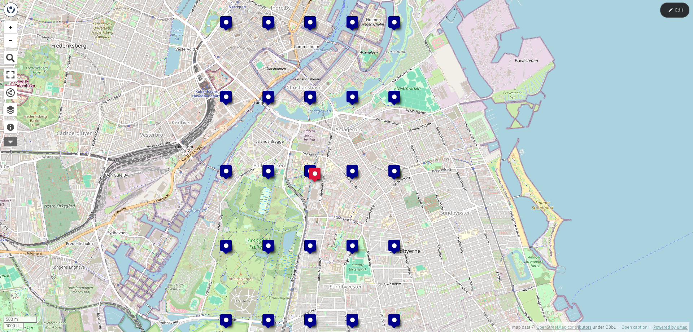
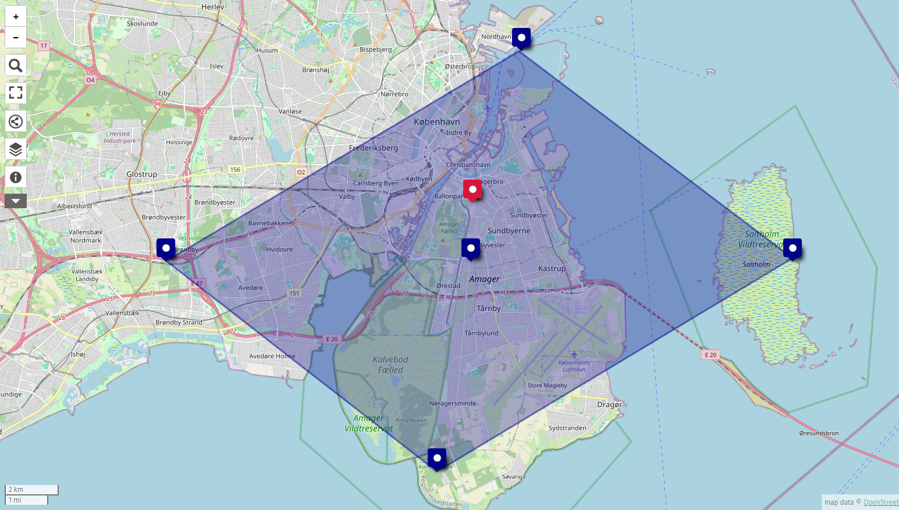

# ITU Roof Solar Pannels Data

This repository includes:
* scripts to fetch and transform NWP and generation data to PVNet expected format
* PV generation and NWP dataset

## Historical Forecast Data

Data retrieved from [OpenMeteo](https://open-meteo.com/)

Open-Meteo allows to fetch historical forecast data from different NWP models.

- **DMI HARMONIE DINI**: covers the central and northen region of europe, has 2km resolution, runs every 3 hours and forecast next 4 days
- **ECMWF**: covers the entire globe, has a 9 km resolution, runs every hour and forecasts next 16 days

Open-Meteo has 2 different endpoint which can be used to request historical forecast data:

- **Single Runs**: which takes as input the time at which the model was run and how far after should forecasted data be taken into account.
- **Previous Runs**: which takes as input the day of forecast and how long ago should the forecasts have been generated

In both cases it’s important to specify the model used to generate the forecast. In the case of the DMI Harmonie AROME model, which runs every 3 hours, the following API request results will be the same from 00:00-03:00:

- single-runs, run = ”05-08-2026T00”, forecast_days = 1, hourly = “temperature_2m”
- previous-runs, start_date = ”05-08-2026”, end_date = ”05-08-2026”, hourly = “temperature_2m”

If we increment the run parameter used in the single-runs endpoint by 3 hours (i.e. run = ”05-08-2026T03”), we would get the same result as previous-runs from 03:00-06:00, and so forth.

DMI data is only available since 2nd april 2026 for the single-runs model while ECMWF is available since March 2024. While for previous-runs model DMI and ECMWF are both available since January 2024.

## PVNet

PVNet expects the data to be in a Zarr format. Zarr is cloud-native format used to store large multidimensional data like measurements over time.

### Forecast Data

For forecast data it expects the following arrays:

Coordinates:

- `init_time_utc`: time when the model was run (datetime)
- `step`: how far from the model run is the forecast time (timedelta)
- `latitude`: (float)
- `longitude`: (float)
- `channel`: different metrics

Data variables:

- `nwp`:  (init_time_utc, channel, step, latitude, longitude)

PVNet expects weather data to be in grid format. Both the height and the width of the grid have to be odd numbers. The smallest accept size was 5x5. As a result the following grid of latitude/longitude pairs was enforced, generating and area of around 11 km² (1115.93 ha): 

- LATITUDE = [55.64, 55.65, 55.66, 55.67, 55.68]
- LONGITUDE = [12.57, 12.58, 12.59, 12.60, 12.61]

This generates different results for each pair when using the DMI model, however for the ECMWF all values end up being the same since the resolution size is too big. For ECMWF this are the points close to ITU defining the grid. 

Important: Open-Meteo prioritizes coordinates on land over sea to retrieve the nearest specify `&cell_selection=nearest` 

| Point | latitude | longitude | Distance from original point |
| --- | --- | --- | --- |
| Original | 55.641476 |  12.596349 | 0 |
| North  | 55.711773 | 12.621951 | 6.1 km |
| South  | 55.571176 | 12.570850 | 9.9 km |
| West  | 55.641475 | 12.413793 | 11.2 km |
| East  | 55.641475 | 12.778905 | 12.0 km |

(how to transform these coordinates into a grid?)

### PV Generation

For PV generation data it expects the following arrays:

Coordinates:

- `time_utc`: time measurement
- `location_id`: always the same since only one site
- `latitude`:
- `longitude`:

Data variables:

- `generation_mw`:  (time_utc, location_id)
- `capacity_mw`:  (time_utc, location_id)